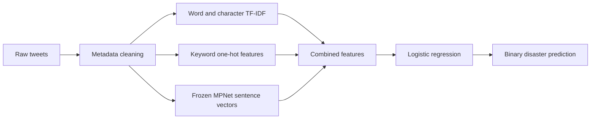

# NLP · Disaster Prediction

**Can a tweet distinguish a real disaster from a metaphor?**

A reproducible NLP project that follows the full workflow: exploratory analysis, missing-value handling, duplicate-aware validation, baseline modeling, and a stronger model with pretrained sentence embeddings.


[Results](#results) · [Project structure](#project-structure) · [Quick start](#quick-start) · [Method](#method) · [Reports](#reports)

## Results

The final candidate combines **word/character TF-IDF, keyword metadata, and frozen MPNet sentence embeddings**. It improved every outer validation fold over the original text + keyword model.

| Experiment | Evaluation | Positive-class F1 |
| --- | --- | ---: |
| Text only | Five grouped folds, pooled OOF | 0.7650 |
| Text + keyword | Five grouped folds, pooled OOF | 0.7699 |
| Text + keyword + location | Five grouped folds, pooled OOF | 0.7703 |
| Sparse model/threshold search | Nested grouped CV, pooled OOF | 0.7664 |
| **TF-IDF + keyword + MPNet** | **Nested grouped CV, pooled OOF** | **0.7973** |

The sparse search was rejected rather than presented as an improvement. Adding sentence embeddings raised recall from **0.7282 to 0.7808**, with precision changing from **0.8166 to 0.8144**.


**These are local validation results, not Kaggle leaderboard scores.** The same outer folds have been reused while exploring model families, so a fresh independent evaluation is needed to confirm the gain. Nested CV separates model/threshold tuning from each outer evaluation within a search; it does not eliminate all bias from repeated experimentation.

The current submission candidate is [submissions/submission_improved.csv](submissions/submission_improved.csv). The original and rejected candidates are retained for comparison.

## Project structure

```text
NLP-disaster-prediction/
├── data/
│   ├── raw/                  # Original Kaggle CSVs; local only
│   └── processed/            # Reproducible cleaned data; local only
├── notebooks/
│   ├── 01_eda.ipynb          # Executed EDA and missing-value audit
│   └── 02_baseline.ipynb     # Executed baseline comparison
├── reports/
│   ├── eda/                  # Data findings, tables, and figures
│   ├── baseline/             # Fixed folds, metrics, and OOF predictions
│   ├── sparse/               # Rejected sparse search
│   ├── semantic/             # Nested validation for the final candidate
│   ├── submission/           # Original submission probabilities/provenance
│   └── html/                 # Local standalone notebook exports
├── scripts/                  # Analysis, evaluation, and submission commands
├── src/disaster_tweets/       # Shared preprocessing, features, paths, and search
├── submissions/              # Original, rejected, and improved prediction files
├── pyproject.toml            # Installable project and optional semantic dependencies
├── requirements.txt          # Pinned baseline/notebook dependencies
└── requirements-semantic.txt # Pinned embedding dependencies
```

Raw data, generated processed data, virtual environments, downloaded weights, embedding caches, and local credentials are excluded from Git. Executed notebooks, reports, figures, metrics, and small submission files are included.

## Quick start

### 1. Set up the environment

Python **3.12+** is required; the recorded run used **Python 3.14** on Apple Silicon.

```sh
python3 -m venv .venv
source .venv/bin/activate
python -m pip install -e .
```

For the sentence-embedding experiment, install the semantic extra:

```sh
python -m pip install -e '.[semantic]'
```

On Windows, activate with `.venv\Scripts\activate`. The requirements files provide the same pinned direct dependencies for environments that use them separately.

### 2. Add the competition data

Download the files from [Kaggle — Natural Language Processing with Disaster Tweets](https://www.kaggle.com/competitions/nlp-getting-started/data) and place them under `data/raw/`:

```text
train.csv
test.csv
sample_submission.csv
```

Run the following commands from the project root.

### 3. Rebuild EDA and baseline notebooks

```sh
python scripts/build_notebooks.py eda
python scripts/build_notebooks.py baseline
```

These commands execute the notebooks, regenerate reports, and create local HTML exports. To run without rebuilding notebooks:

```sh
python scripts/eda.py
python scripts/baseline.py
```

### 4. Generate submission candidates

First generate the original reference submission. The semantic experiment uses the saved baseline folds and predictions to compare results consistently.

```sh
python scripts/create_submission.py
python scripts/improve_semantic_model.py
```

The first semantic run downloads the public MPNet weights and caches frozen embeddings in `.cache/sentence_embeddings/`. MPS is used on supported Macs; otherwise encoding uses CPU. Later runs reuse a cache validated by source/model hashes.

The improved file is written to **`submissions/submission_improved.csv`**. Scripts generate files locally and do not submit to Kaggle automatically.

To reproduce the rejected sparse experiment:

```sh
python scripts/improve_model.py
```

## Dataset and EDA

The task classifies tweets, not the future occurrence of physical disasters. `target=1` denotes a disaster-related tweet and `target=0` a non-disaster tweet.

| Property | Observed value |
| --- | ---: |
| Training rows | 7,613 |
| Test rows | 3,263 |
| Positive class | 42.97% |
| Missing keyword | 61 rows / 0.80% |
| Missing location | 2,534 rows / 33.29% |
| Missing text or target | 0 |
| Exact-text groups with conflicting labels | 18 groups / 55 rows |

Missing keyword/location values, including whitespace-only values, are marked `__MISSING__` after trimming. No rows are dropped, and raw text, IDs, and labels remain unchanged. Conflicting labels are exported for review rather than automatically rewritten.

The EDA also examines tweet lengths, URLs, hashtags, mentions, keyword disaster rates with Wilson intervals, location quality, class-normalized word/bigram frequencies, and row ordering.

## Method



**Validation.** Five fixed, approximately class-stratified outer folds group conservative normalized duplicates together. Normalization unescapes HTML, applies Unicode NFKC/case folding, and collapses whitespace. No such group crosses a train/validation boundary. Near duplicates and event overlap can remain.

**Tuning.** Within each outer training set, three grouped inner folds select from 13 predefined configurations and 11 decision-margin thresholds. Vocabularies, IDF values, keyword categories, and supervised feature weights are fitted within the corresponding training subset. Globally optimized selection scores are labeled separately from nested evaluation scores in the reports.

**Final model.** Logistic regression with L2 regularization, `C=0.5`, `liblinear`, and seed 42. Features are the original word TF-IDF (1–2 grams), character TF-IDF (3–5 grams), keyword one-hot values, and 768-dimensional normalized sentence embeddings at weight 2. Location and IDs are excluded. The final decision-margin threshold is `-0.1`, equivalent to probability approximately `0.4750` for this logistic classifier.

**Pretrained encoder.** [sentence-transformers/all-mpnet-base-v2](https://huggingface.co/sentence-transformers/all-mpnet-base-v2), pinned to revision `e8c3b32edf5434bc2275fc9bab85f82640a19130`. The encoder is frozen; no competition labels are used to produce embeddings. Its original pretraining corpus has not been audited for overlap with the competition texts. Sequence length is capped at 128 tokens; none of the supplied texts was truncated after embedding preprocessing.

## Reports

| Artifact | What to inspect |
| --- | --- |
| [EDA report](reports/eda/report.md) | Data quality, missing values, and lexical patterns |
| [Baseline report](reports/baseline/report.md) | Three metadata configurations on identical folds |
| [Sparse experiment](reports/sparse/report.md) | Search that did not improve nested validation |
| [Semantic experiment](reports/semantic/report.md) | Final candidate, nested scores, and limitations |
| [Nested fold metrics](reports/semantic/nested_fold_metrics.csv) | Per-fold settings and baseline comparison |
| [Candidate comparison](reports/semantic/candidate_comparison.csv) | All semantic candidates and selection scores |
| [Submission candidates](submissions/README.md) | Which file to use and why |

Source hashes, model settings, cache provenance, decision thresholds, and prediction counts are recorded in the relevant JSON files. All submission files are checked for sample ID order, 3,263 rows, integer binary targets, and missing values.

## Interpretation

The [official Kaggle FAQ](https://www.kaggle.com/c/nlp-getting-started) explains that test labels are public and perfect submissions can therefore appear on the leaderboard. This project does not retrieve those labels or copy leaderboard answers; it uses the supplied training labels for supervised fitting and evaluation. A perfect leaderboard score alone is not evidence of generalization to new tweets.

Further work could evaluate fresh event-separated data, investigate label conflicts, and fine-tune a transformer under the same leakage controls. Those experiments have not been performed here.
