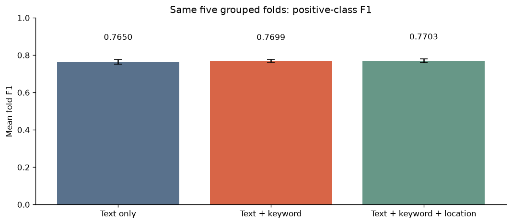
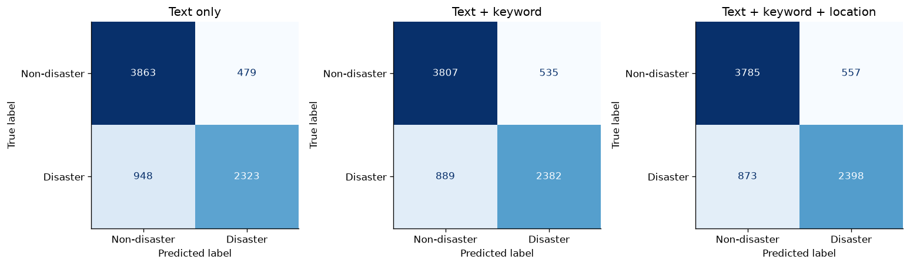

# Missing values and feature comparison

## Applied policy

- Preserve all 7,613 training rows and keep raw text, IDs, and targets unchanged.
- Trim keyword/location strings; replace empty, whitespace-only, or null values with `__MISSING__`.
- Keyword: 61 explicit missing markers. Location: 2534 markers (including one whitespace-only source value).
- Save the result as `../../data/processed/train_processed.csv`. This replaces unknown information with a marker, not a guessed real value. The raw CSV is unchanged.

## Three-model comparison

| label | mean_fold_f1 | std_fold_f1 | oof_f1 | oof_precision | oof_recall | oof_accuracy | delta_oof_f1_vs_text |
| --- | --- | --- | --- | --- | --- | --- | --- |
| Text only | 0.7650 | 0.0131 | 0.7650 | 0.8291 | 0.7102 | 0.8126 | 0.0000 |
| Text + keyword | 0.7699 | 0.0074 | 0.7699 | 0.8166 | 0.7282 | 0.8130 | 0.0049 |
| Text + keyword + location | 0.7703 | 0.0098 | 0.7703 | 0.8115 | 0.7331 | 0.8122 | 0.0053 |

All F1, precision, and recall values refer to the positive disaster class. OOF scores pool predictions for all rows; each row is predicted exactly once by a model trained outside its validation fold. Mean fold F1 is the average of five separate F1 scores. Fold standard deviation is not a confidence interval.

Adding keyword changes pooled OOF F1 from **0.7650 to 0.7699** (+0.0049). Adding location on top of keyword changes it to **0.7703** (+0.0004 versus keyword).

## Validation design and settings

- Five fixed StratifiedGroupKFold folds, shuffled, seed 42. Conservative normalized text groups never cross train/validation boundaries. Grouping applies HTML unescape, Unicode NFKC, case folding, and whitespace collapse. Class stratification is approximate because groups are indivisible.
- The same folds, classifier, threshold, and text feature settings are used in all three experiments. IDs and row position are excluded from inputs.
- Word TF-IDF: 1–2 grams, min_df=2, max_features=30,000. Character TF-IDF: char_wb 3–5 grams, min_df=2, max_features=50,000. Both use lowercase, sublinear TF, and default L2 normalization. No stopword removal or URL stripping is applied.
- Keyword is one-hot encoded. Location is one-hot encoded with min_frequency=5 in each training fold. Unknown categories are ignored. Feature block weights are all 1.
- Logistic regression: C=1, L2 penalty, liblinear, max_iter=1000, no class weighting, seed 42. Decision threshold is fixed at 0.5; no parameter or threshold tuning is performed.
- Vocabulary, IDF, metadata categories, and rare-location grouping are fitted on training-fold data only. Missing-value handling is a deterministic transformation with no learned statistics.
- Conflicting labels are retained without modification and grouped together. Near duplicates, event/topic overlap, and label noise remain possible. This is not a time- or event-held-out test, and feature selection on these folds is not independent final evaluation.

## How to use these results

Keep the text-only score as the reference. Treat any metadata gain as provisional and check it with another split or nested evaluation before increasing pipeline complexity. Compare the paired fold metrics and the false positives/negatives, rather than relying only on the largest aggregate score. Raw location values describe supplied profile metadata and need not be the location of a disaster.

## Artifacts and reproduction

- `model_comparison.csv`: all three scores; `fold_metrics.csv`: fold-level metrics.
- `fold_assignments.csv` and `fold_audit.csv`: fixed validation membership and zero duplicate-group overlap.
- `oof_predictions.csv`: prediction and probability for each row/model; `validation_errors.csv`: errors with text and metadata for review.
- `metrics.json`: machine-readable results and source hash.
- Run `python scripts/baseline.py` from the project root, or `python scripts/build_notebooks.py baseline` to rebuild the executed `../../notebooks/02_baseline.ipynb` and HTML export.

No final model is fitted on all rows and no test-set predictions are generated in this comparison. Source SHA-256: `61111c6dc31eaffa34d1e1fa62e2395325c9bc3b38bba1941a5f1ed9b3fa60df`.
