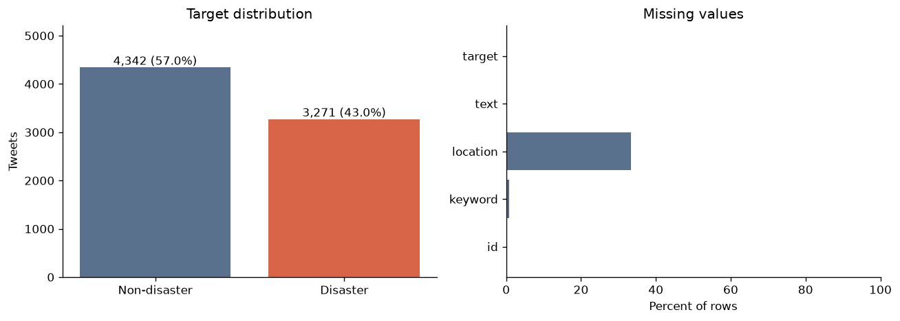
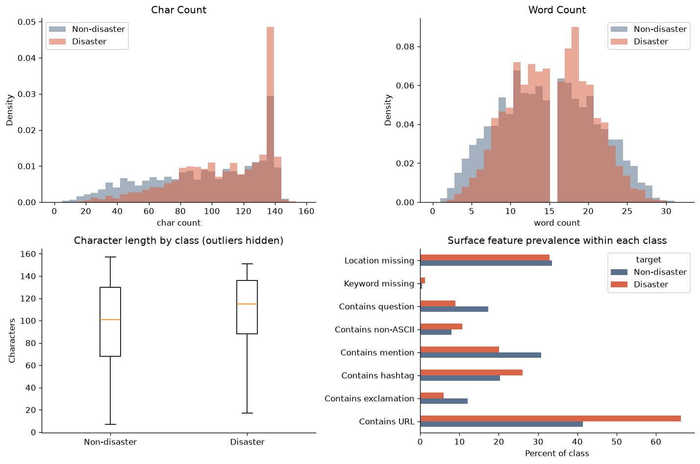
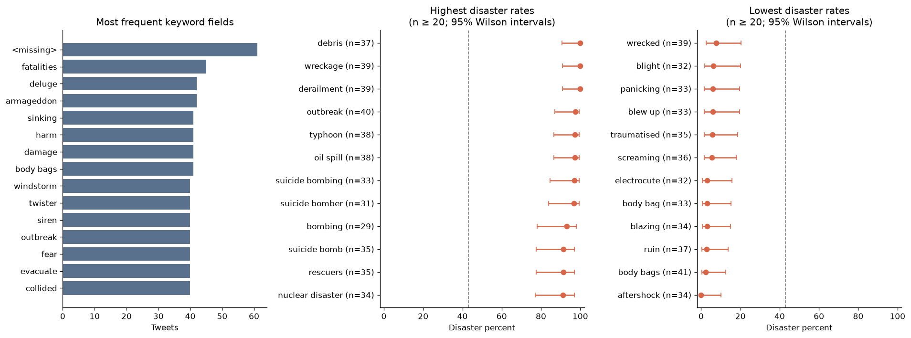
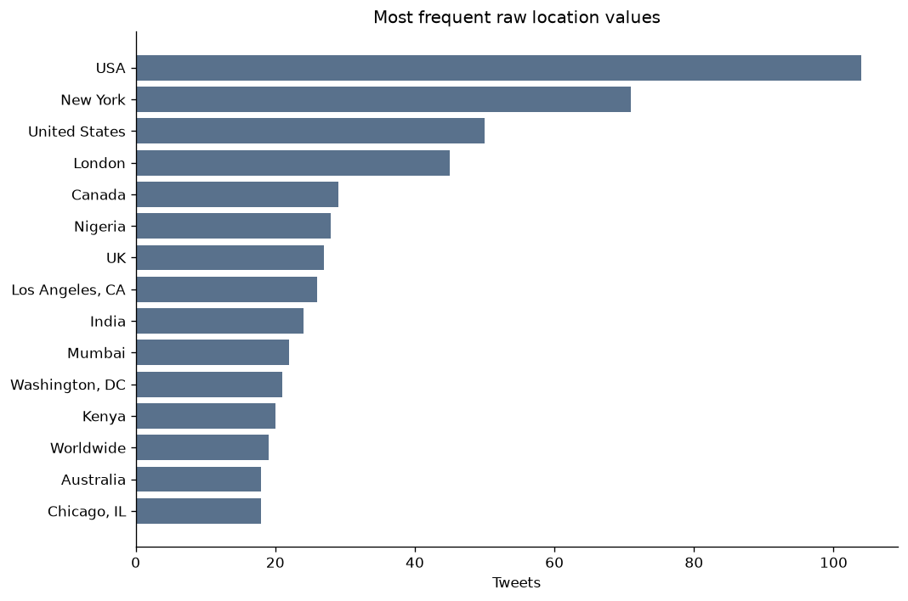
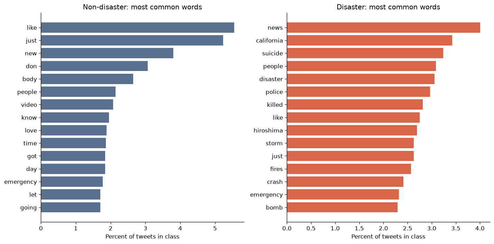
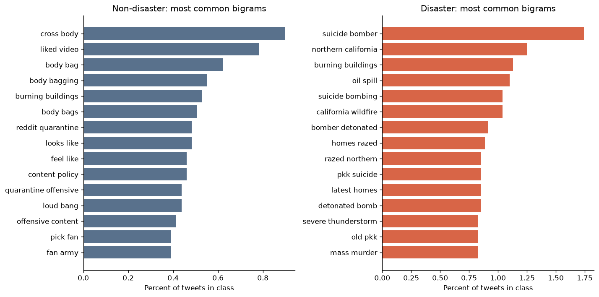
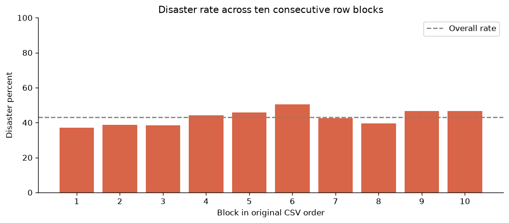

# train.csv — Exploratory Data Analysis

## Scope and main findings

This report analyzes the supplied **train.csv only**, containing **7,613 tweets and 5 columns**.
Target 1 is interpreted as disaster-related; target 0 as non-disaster.
The source CSV remains unchanged. No model training or test-set analysis is included.

- **Class balance:** 3,271 disaster tweets (42.97%) and 4,342 non-disaster tweets (57.03%). The imbalance is moderate; always predicting 0 gives 57.03% accuracy on this sample, not a useful F1 baseline for the positive class.
- **Missing metadata:** keyword is missing in 61 rows (0.80%); location in 2,534 rows (33.29%). Text, ID, and target have no missing entries. There are 0 duplicate IDs.
- **Repeated text:** 69 exact-text groups contain 179 rows, representing 110 excess rows after keeping one per text. **18 exact-text groups (55 rows) contain both labels.** Conflicts may reflect annotation noise or missing context and require review.
- **Length:** disaster tweets average 108.1 characters versus 95.7 for non-disaster tweets. Average whitespace word counts are 15.17 and 14.70, respectively. Raw character lengths include URLs; length alone cannot establish classification quality.
- **Metadata:** 221 distinct non-null keywords and 3,341 distinct raw locations. Location is sparse, free-form, and high cardinality.

## Data overview

| column | dtype | missing_count | missing_pct | unique_non_null |
| --- | --- | --- | --- | --- |
| id | int64 | 0 | 0.000 | 7613 |
| keyword | string | 61 | 0.800 | 221 |
| location | string | 2534 | 33.290 | 3341 |
| text | string | 0 | 0.000 | 7503 |
| target | int64 | 0 | 0.000 | 2 |

## Applied missing-value handling

All 7,613 rows are retained in `../../data/processed/train_processed.csv`. Empty and whitespace-only keyword/location values are replaced with `__MISSING__` after trimming. Text, IDs, and labels are unchanged. The location count includes one whitespace-only value, so `isna()` alone undercounts missing locations by one.

| column | missing_before | missing_after | missing_marker_count |
| --- | --- | --- | --- |
| keyword | 61 | 0 | 61 |
| location | 2534 | 0 | 2534 |

The marker means that information was not supplied; it is not an inferred keyword or location. Raw-data previews and EDA statistics intentionally retain the original missingness. Open the processed preview in `../../notebooks/01_eda.ipynb` to see the filled values. The three-model feature comparison is available separately in `../baseline/report.md` and `../../notebooks/02_baseline.ipynb` after running the baseline analysis.

## Duplicate and label-quality audit

| matching_rule | duplicate_groups | rows_in_duplicate_groups | excess_duplicate_rows | conflicting_groups | rows_in_conflicting_groups |
| --- | --- | --- | --- | --- | --- |
| text | 69 | 179 | 110 | 18 | 55 |
| normalized_text | 70 | 182 | 112 | 18 | 56 |
| template_text | 305 | 974 | 669 | 69 | 245 |

Exact matching uses original text. Conservative matching decodes HTML entities, applies Unicode NFKC, case folding, and whitespace collapse. Template matching also replaces URLs and mentions and is a candidate-review heuristic, not an assertion of semantic identity.

Conservative normalization produces 70 duplicate groups and 18 conflicting groups. Inspect `tables/exact_label_conflicts.csv` for the complete exact conflict audit. Identical text can have different keyword/location fields; review full records before deciding whether context explains a conflict. Do not blindly keep the first label or replace labels by majority vote.

## Text features

Percent of tweets within each target class containing each feature:

| feature | Non-disaster (%) | Disaster (%) |
| --- | --- | --- |
| Contains URL | 41.430 | 66.400 |
| Contains exclamation | 12.050 | 5.990 |
| Contains hashtag | 20.290 | 26.050 |
| Contains mention | 30.820 | 20.060 |
| Contains non-ASCII | 8.010 | 10.670 |
| Contains question | 17.270 | 8.930 |
| Keyword missing | 0.440 | 1.280 |
| Location missing | 33.580 | 32.900 |

URLs occur in 66.40% of disaster tweets and 41.43% of non-disaster tweets. These patterns can reflect source or reporting style. They are descriptive associations and need held-out validation before being treated as useful model features.

The longest observed tweet has 157 raw characters. Choose any future tokenizer length from token-length measurements, rather than assuming character and token lengths are interchangeable. The 90th, 95th, and 99th length percentiles are in `tables/length_quantiles.csv`; longest and shortest examples are also exported.

## Keyword patterns

The following keywords have at least 20 examples. Disaster rate is a fraction from 0 to 1. Counts and 95% Wilson intervals are included because these samples are small. The intervals do not account for duplicate dependence or multiple comparisons.

Highest observed rates:

| keyword | count | disaster_count | disaster_rate | wilson_low | wilson_high |
| --- | --- | --- | --- | --- | --- |
| derailment | 39 | 39 | 1.000 | 0.910 | 1.000 |
| wreckage | 39 | 39 | 1.000 | 0.910 | 1.000 |
| debris | 37 | 37 | 1.000 | 0.906 | 1.000 |
| outbreak | 40 | 39 | 0.975 | 0.871 | 0.996 |
| oil spill | 38 | 37 | 0.974 | 0.865 | 0.995 |
| typhoon | 38 | 37 | 0.974 | 0.865 | 0.995 |
| suicide bombing | 33 | 32 | 0.970 | 0.847 | 0.995 |
| suicide bomber | 31 | 30 | 0.968 | 0.838 | 0.994 |

Lowest observed rates:

| keyword | count | disaster_count | disaster_rate | wilson_low | wilson_high |
| --- | --- | --- | --- | --- | --- |
| aftershock | 34 | 0 | 0.000 | 0.000 | 0.102 |
| body bags | 41 | 1 | 0.024 | 0.004 | 0.126 |
| ruin | 37 | 1 | 0.027 | 0.005 | 0.138 |
| blazing | 34 | 1 | 0.029 | 0.005 | 0.149 |
| body bag | 33 | 1 | 0.030 | 0.005 | 0.153 |
| electrocute | 32 | 1 | 0.031 | 0.006 | 0.157 |
| screaming | 36 | 2 | 0.056 | 0.015 | 0.181 |
| traumatised | 35 | 2 | 0.057 | 0.016 | 0.186 |

Even explicitly disaster-themed words can appear in jokes, metaphors, entertainment, or unrelated discussion. Keyword identity is not a label substitute. URL-decode keyword values, retain a missing-value marker, and evaluate their incremental contribution alongside text.

## Location patterns

| location | count | disaster_rate |
| --- | --- | --- |
| USA | 104 | 0.644 |
| New York | 71 | 0.225 |
| United States | 50 | 0.540 |
| London | 45 | 0.356 |
| Canada | 29 | 0.448 |
| Nigeria | 28 | 0.786 |
| UK | 27 | 0.593 |
| Los Angeles, CA | 26 | 0.308 |
| India | 24 | 0.833 |
| Mumbai | 22 | 0.864 |

These values can describe the author's profile rather than the event. Do not equate a raw location with verified geography. Keep missing locations as an explicit value instead of dropping one third of the training rows. If location is later encoded using targets, fit that encoding strictly within training folds.

## Vocabulary and repeated phrases

Word and bigram plots use document frequencies after removing URL strings, mentions, and a fixed English stopword list. They show class-normalized prevalence, rather than raw counts from unequal class sizes. At least 20 documents are required for words and 10 for bigrams. This normalization is for EDA, not a mandated modeling pipeline.

See `tables/words_document_frequencies.csv` and `tables/bigrams_document_frequencies.csv` for exact counts and smoothed log2 prevalence ratios. Positive ratios indicate greater prevalence in disaster tweets; negative ratios indicate greater prevalence in non-disaster tweets. Minimum-frequency filtering and smoothing reduce, but do not eliminate, instability. Repeated messages can amplify particular terms. These patterns do not prove that a phrase generalizes to unseen events.

## Row order and validation

The file contains 222 contiguous keyword runs for 222 distinct values including missing. IDs are monotonically increasing: True. Contiguous train/validation slices can therefore produce uneven topic coverage. IDs are identifiers and should be excluded from model inputs; they are not timestamps.

## Suggested starting workflow

1. Preserve raw text and review the exported label conflicts before applying a cleaning policy. Record decisions rather than silently altering labels.
2. Create a fixed, approximately class-stratified validation split that groups conservative normalized duplicates together (for example, StratifiedGroupKFold). Review template matches separately; replacing URLs and mentions can merge distinct events. For stricter generalization checks, assess event/topic overlap once suitable groups are available. No event/time holdout can be claimed from this file alone.
3. Start with a word/character TF-IDF plus logistic regression baseline. Fit vocabulary, IDF, and any feature selection on training folds only. Compare text alone against text plus keyword; test location separately because it is sparse and noisy.
4. Preserve hashtag words and negation. Test URL/mention normalization as an experiment; avoid irreversible stripping of all punctuation or stopwords, especially if later using a pretrained language model.
5. Report positive-class F1, precision, recall, and a confusion matrix on held-out data. Tune any decision threshold inside training/validation folds, and compare performance under a consistent duplicate policy.

These are proposed experiments; this EDA does not establish model accuracy, causal effects, or population prevalence.

## Reproduce and inspect

- Run `python scripts/eda.py` in the project environment to regenerate figures, tables, metrics, and this report.
- Open `eda_train.ipynb` for the executed cells and outputs; `eda_train.html` is a standalone HTML export of that notebook.
- Full machine-readable metrics: `summary.json`. Source SHA-256: `61111c6dc31eaffa34d1e1fa62e2395325c9bc3b38bba1941a5f1ed9b3fa60df`.
