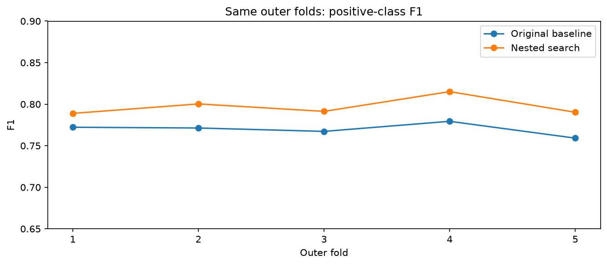

# Model improvement with nested grouped validation

## Measured comparison

| method | f1 | precision | recall | accuracy |
| --- | --- | --- | --- | --- |
| Original text + keyword, fixed threshold | 0.7699 | 0.8166 | 0.7282 | 0.8130 |
| Nested model/threshold search | 0.7973 | 0.8144 | 0.7808 | 0.8294 |

Nested mean fold F1: **0.7972**, fold standard deviation **0.0110**. Original mean fold F1: **0.7699**. Pooled out-of-fold F1 change: **+0.0274**.

Decision: adopt as the next submission candidate because nested validation improved. Kaggle test performance has not been measured.

## Selection is separated from outer evaluation

The original five normalized-text-grouped folds are reused. For each outer training set, three additional grouped inner folds compare a predefined set of 13 models and 11 decision-margin thresholds. Model and threshold are selected using inner predictions only, then evaluated on the held-out outer fold. Every vectorizer, IDF value, categorical encoder, and supervised NB weight is fitted within its training subset. No normalized duplicate group crosses a boundary. Conflicting labels remain unchanged.

| fold | selected_model | threshold_margin | f1 | baseline_f1 | delta_f1_vs_baseline |
| --- | --- | --- | --- | --- | --- |
| 1 | hybrid_lr_0.5 | -0.2000 | 0.7889 | 0.7722 | 0.0167 |
| 2 | hybrid_lr_0.5 | -0.2000 | 0.8003 | 0.7713 | 0.0290 |
| 3 | hybrid_lr_0.5 | -0.2000 | 0.7913 | 0.7673 | 0.0241 |
| 4 | hybrid_lr_0.5 | -0.2000 | 0.8151 | 0.7794 | 0.0357 |
| 5 | hybrid_lr_0.5 | -0.1000 | 0.7903 | 0.7591 | 0.0311 |

Nested OOF performance evaluates the **selection procedure**, which can choose a different configuration in each outer fold. Final settings are subsequently selected by CV on all training rows. The final configuration's globally optimized selection score is optimistic and is not substituted for the nested score. Thresholds for SVMs are uncalibrated margins, not probabilities. Zero is the original decision threshold; for logistic regression, probability is sigmoid(margin).

## Candidate methods

The original TF-IDF + keyword logistic regression is included and reproduces the saved baseline predictions and probabilities.

Frozen sentence embeddings come from [sentence-transformers/all-mpnet-base-v2](https://huggingface.co/sentence-transformers/all-mpnet-base-v2) at pinned revision `e8c3b32edf5434bc2275fc9bab85f82640a19130`. The pretrained encoder is not fine-tuned on this competition. Its 768-dimensional outputs are L2-normalized. URL strings are removed, mentions are replaced with @user, HTML entities are unescaped, and whitespace is collapsed before encoding; case and hashtag words are preserved. Maximum sequence length is 128; 0 of 10678 unique texts are truncated.

The encoder computes each text independently without competition labels or learned corpus statistics. Its outputs can therefore be cached once for train/test; no TF-IDF, classifier, category mapping, or supervised statistics are fitted on validation/test rows. This uses a general pretrained model, not a competition-specific model with unknown validation overlap. The encoder's original pretraining corpus has not been audited for overlap with these texts.

- `embedding`: frozen sentence vectors alone.
- `embedding_keyword`: sentence vectors plus keyword one-hot features at weight .5; keyword categories are fitted within the training subset.
- `hybrid`: the original word/character TF-IDF + keyword representation, plus sentence vectors at weight 2. Original TF-IDF/keyword features are fitted within the training subset.
- Logistic regression: L2, liblinear, max_iter=1000, seed 42, C as recorded in the candidate table. LinearSVC: L2 squared-hinge, max_iter=10,000, seed 42. No class weighting. Locations and IDs are excluded.

This semantic family was attempted after the sparse search failed on the same outer folds. Nested validation separates tuning from each outer fold inside this predefined search, but adaptive model-family exploration on reused folds can still cause selection bias. A fresh independent evaluation is needed to confirm the final gain.

| model | threshold_margin | selection_f1_optimistic | fixed_threshold_oof_f1 |
| --- | --- | --- | --- |
| hybrid_lr_0.5 | -0.1000 | 0.7980 | 0.7979 |
| embedding_keyword_lr_4 | -0.0000 | 0.7958 | 0.7958 |
| embedding_keyword_lr_1 | -0.1000 | 0.7945 | 0.7936 |
| hybrid_lr_1 | 0.1000 | 0.7942 | 0.7939 |
| embedding_lr_1 | -0.1000 | 0.7891 | 0.7849 |
| embedding_lr_4 | -0.1000 | 0.7870 | 0.7867 |
| embedding_svc_1 | -0.1000 | 0.7861 | 0.7849 |
| embedding_keyword_lr_16 | -0.0000 | 0.7860 | 0.7860 |
| embedding_lr_16 | -0.0000 | 0.7827 | 0.7827 |
| hybrid_lr_4 | -0.2000 | 0.7815 | 0.7814 |
| embedding_svc_4 | -0.1000 | 0.7800 | 0.7783 |
| embedding_lr_64 | -0.1000 | 0.7753 | 0.7742 |
| original_lr | -0.1000 | 0.7724 | 0.7699 |

The `selection_f1_optimistic` column uses the same training-only OOF labels to choose model and threshold; it is a tuning score, not independent evaluation. `fixed_threshold_oof_f1` uses margin threshold zero but still involves comparing multiple candidates. Fold standard deviation is not a confidence interval. The original folds were used for prior model comparisons too; no new independent final test score is available.

## Final submission

Selected configuration: **hybrid_lr_0.5**. Decision-margin threshold: **-0.10**. Fit on all 7,613 training rows, predict all 3,263 test rows, and align to sample_submission.csv. Output: `../../submissions/submission_improved.csv`. The existing `../../submissions/submission.csv` is preserved. No test labels, additional disaster-labeled examples, or leaderboard feedback are used. No Kaggle upload has been performed.

## Why leaderboard scores can be 1.0

The [official Kaggle FAQ](https://www.kaggle.com/c/nlp-getting-started) says test labels are public and explains that this can produce perfect submissions. A perfect leaderboard score is therefore not evidence, by itself, of generalization to unseen tweets. This experiment uses the supplied training labels only. Local validation scores and Kaggle test scores are different evaluations.

## Reproduce

Run `python scripts/improve_semantic_model.py` from the project root. `inner_search.csv`, `candidate_fold_metrics.csv`, `candidate_comparison.csv`, `nested_fold_metrics.csv`, and `oof_predictions.csv` preserve the search and predictions. `test_scores.csv` stores final decision scores; `metrics.json` records settings, hashes, prediction counts, and runtime.
