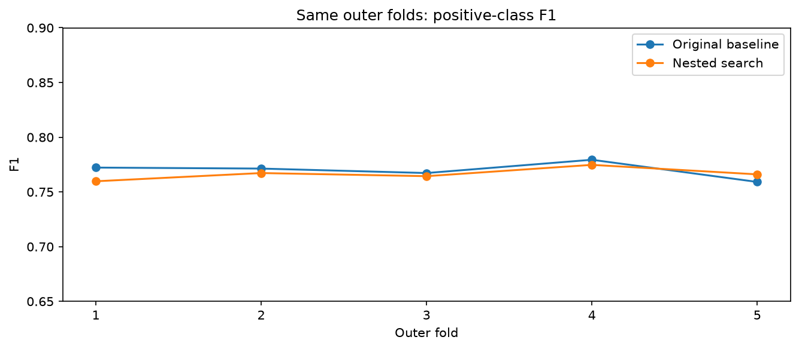

# Model improvement with nested grouped validation

## Measured comparison

| method | f1 | precision | recall | accuracy |
| --- | --- | --- | --- | --- |
| Original text + keyword, fixed threshold | 0.7699 | 0.8166 | 0.7282 | 0.8130 |
| Nested model/threshold search | 0.7664 | 0.7557 | 0.7774 | 0.7964 |

Nested mean fold F1: **0.7664**, fold standard deviation **0.0054**. Original mean fold F1: **0.7699**. Pooled out-of-fold F1 change: **-0.0035**.

Decision: do not adopt; nested validation did not improve on the original submission. Kaggle test performance has not been measured.

## Selection is separated from outer evaluation

The original five normalized-text-grouped folds are reused. For each outer training set, three additional grouped inner folds compare a predefined set of 13 models and 11 decision-margin thresholds. Model and threshold are selected using inner predictions only, then evaluated on the held-out outer fold. Every vectorizer, IDF value, categorical encoder, and supervised NB weight is fitted within its training subset. No normalized duplicate group crosses a boundary. Conflicting labels remain unchanged.

| fold | selected_model | threshold_margin | f1 | baseline_f1 | delta_f1_vs_baseline |
| --- | --- | --- | --- | --- | --- |
| 1 | original_lr | -0.4000 | 0.7597 | 0.7722 | -0.0125 |
| 2 | original_lr | -0.3000 | 0.7672 | 0.7713 | -0.0041 |
| 3 | original_lr | -0.2000 | 0.7644 | 0.7673 | -0.0029 |
| 4 | original_lr | -0.3000 | 0.7747 | 0.7794 | -0.0047 |
| 5 | original_lr | -0.3000 | 0.7661 | 0.7591 | 0.0069 |

Nested OOF performance evaluates the **selection procedure**, which can choose a different configuration in each outer fold. Final settings are subsequently selected by CV on all training rows. The final configuration's globally optimized selection score is optimistic and is not substituted for the nested score. Thresholds for SVMs are uncalibrated margins, not probabilities. Zero is the original decision threshold; for logistic regression, probability is sigmoid(margin).

## Candidate methods

The original TF-IDF + keyword logistic regression is included and reproduces the saved baseline predictions and probabilities. New representations unescape HTML, normalize Unicode NFKC and curly apostrophes, lowercase, replace URLs/@mentions with tokens, expand can't/won't/n't, and collapse whitespace. Raw CSV text remains unchanged. Stopwords, hashtag words, and negation are retained.

- Clean word TF-IDF: 1–2 grams, min_df=2, max_df=.98, max_features=50,000, sublinear TF, L2 normalization.
- Clean character TF-IDF: char_wb 3–5 grams, min_df=2, max_features=60,000, sublinear TF, L2 normalization; character block weight .5. Optional keyword one-hot block weight 1.
- Binary word counts: 1–2 grams, min_df=2, max_df=.98, max_features=100,000, token length at least one. For NB-weighted models, features are multiplied by the training-only smoothed class log-count ratio (alpha=1) before fitting a linear classifier. This is inspired by [Wang and Manning (2012)](https://aclanthology.org/P12-2018/); it is not a claim to reproduce every setting in that paper.
- Logistic regression: liblinear, C in the candidate table, max_iter=1000. LinearSVC: L2 squared-hinge loss, C in the candidate table, max_iter=10,000. Random state 42, no class weighting. Locations and IDs are excluded. See `metrics.json` for every candidate.

| model | threshold_margin | selection_f1_optimistic | fixed_threshold_oof_f1 |
| --- | --- | --- | --- |
| original_lr | -0.1000 | 0.7724 | 0.7699 |
| clean_wordchar_keyword_lr_1 | -0.2000 | 0.7684 | 0.7642 |
| clean_wordchar_keyword_lr_4 | -0.1000 | 0.7632 | 0.7614 |
| clean_wordchar_svc_05 | -0.1000 | 0.7579 | 0.7543 |
| clean_word_lr_1 | -0.2000 | 0.7550 | 0.7473 |
| clean_word_lr_4 | -0.2000 | 0.7543 | 0.7523 |
| clean_wordchar_svc_1 | -0.0000 | 0.7508 | 0.7508 |
| clean_word_svc_05 | -0.1000 | 0.7505 | 0.7501 |
| nb_word_lr_1 | -0.2000 | 0.7489 | 0.7430 |
| clean_word_svc_1 | -0.0000 | 0.7454 | 0.7454 |
| nb_word_lr_4 | -0.6000 | 0.7353 | 0.7330 |
| nb_word_svc_05 | -0.2000 | 0.7250 | 0.7170 |
| nb_word_svc_1 | -0.1000 | 0.7142 | 0.7127 |

The `selection_f1_optimistic` column uses the same training-only OOF labels to choose model and threshold; it is a tuning score, not independent evaluation. `fixed_threshold_oof_f1` uses margin threshold zero but still involves comparing multiple candidates. Fold standard deviation is not a confidence interval. The original folds were used for prior model comparisons too; no new independent final test score is available.

## Final submission

Selected configuration: **original_lr**. Decision-margin threshold: **-0.10**. Fit on all 7,613 training rows, predict all 3,263 test rows, and align to sample_submission.csv. Output: `../../submissions/submission_sparse_candidate.csv`. The existing `../../submissions/submission.csv` is preserved. No test labels, external labeled examples, or leaderboard feedback are used. No Kaggle upload has been performed.

## Why leaderboard scores can be 1.0

The [official Kaggle FAQ](https://www.kaggle.com/c/nlp-getting-started) says test labels are public and explains that this can produce perfect submissions. A perfect leaderboard score is therefore not evidence, by itself, of generalization to unseen tweets. This experiment uses the supplied training labels only. Local validation scores and Kaggle test scores are different evaluations.

## Reproduce

Run `python scripts/improve_model.py` from the project root. `inner_search.csv`, `candidate_fold_metrics.csv`, `candidate_comparison.csv`, `nested_fold_metrics.csv`, and `oof_predictions.csv` preserve the search and predictions. `test_scores.csv` stores final decision scores; `metrics.json` records settings, hashes, prediction counts, and runtime.
